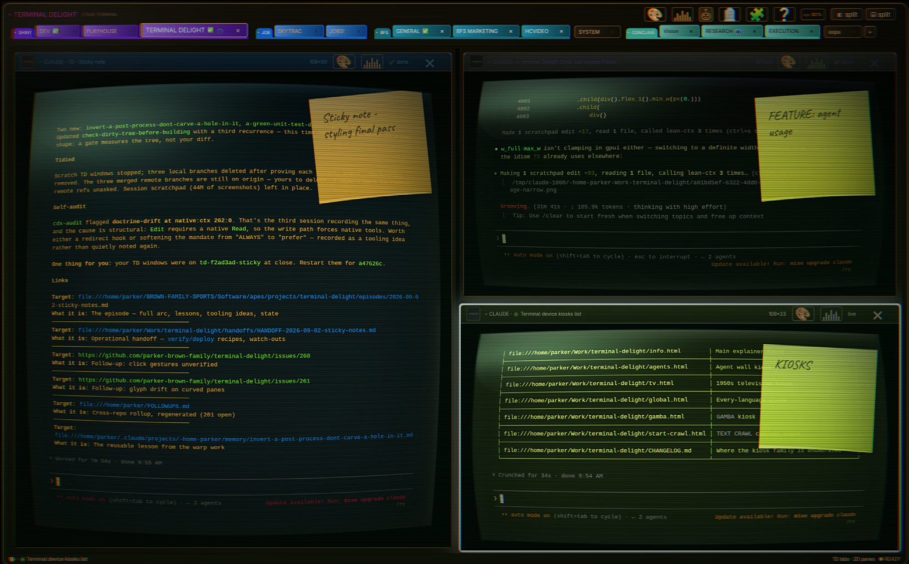
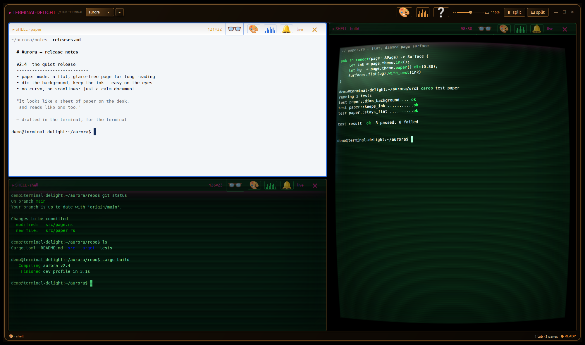

# terminal-delight

A **GPU-native terminal for Linux**, written in Rust, for running many shells and
coding agents in one window. [gpui](https://github.com/zed-industries/zed/tree/main/crates/gpui)
(Zed's GPU UI framework) draws everything; [`rio-vt`](https://crates.io/crates/rio-vt),
the core of the [Rio](https://rioterm.com) terminal, does the VT emulation; your
real shell runs on a real PTY. It was built on [Omarchy](https://omarchy.org) and
runs on any Linux desktop.

**Documentation:** https://docs.terminal-delight.brownfamilysports.com — one page
per feature, each checked against the code and stamped with the commit it is
true of.



<p align="center"><em>One window, twenty real shells — each pane its own tube, theme, and curvature, and every agent on the wall visible from the tab strip.</em></p>

> Screenshots use staged demo content (a throwaway home + fake prompt), never a real shell.

**Platform:** Linux only (X11 & Wayland, via gpui's wgpu renderer). Not macOS or Windows.

## What it does

Terminal Delight watches the Claude Code and Codex agents in its panes, from
their transcripts and their screens, and shows you which ones need you. It does
not orchestrate them. Each item below links to its page in the docs.

**Agents**

- **[The agent wall](https://docs.terminal-delight.brownfamilysports.com/agent-wall)**
  (Ctrl+Shift+A) shows every pane as a card. A Claude agent's card carries three
  bars read from its transcript (context, fatigue, relevance), and they add up to
  a call: RUN, WATCH, COMPACT, HAND OFF or STOP.
- **[Attention](https://docs.terminal-delight.brownfamilysports.com/attention)**
  lives in the tab strip: a badge per agent for working, needs you, done and
  blocked, and a desktop notification with the agent's own last words that
  jumps to the pane when you click it.
- **[The workbench](https://docs.terminal-delight.brownfamilysports.com/workbench)**
  is each pane's second face. A question the agent asks arrives whole, your
  answer goes straight back, and the conversation's history survives a restart.
- **[Launching](https://docs.terminal-delight.brownfamilysports.com/launching)**
  an agent is Alt+A, with the models and effort levels your installed Claude Code
  and Codex actually offer.
- **[The graveyard](https://docs.terminal-delight.brownfamilysports.com/graveyard)**
  finds agent sessions whose panes are gone and resumes them.
- **[Usage](https://docs.terminal-delight.brownfamilysports.com/usage)** shows how
  much of each AI coding subscription is spent and when its window resets, read
  from records a per-vendor collector writes. Terminal Delight collects nothing
  itself.

**Documents and briefs**

- **[Documents](https://docs.terminal-delight.brownfamilysports.com/documents)**
  open inside the terminal. Alt+click a path to a picture, Markdown file, HTML
  page, PDF, video or sound and it opens in a floating square beside the line
  that printed it; Ctrl+Alt+click opens it in a new pane.
- **[Decision briefs](https://docs.terminal-delight.brownfamilysports.com/briefs)**
  and Markdown files take notes, pasted pictures included, and **↪ send to agent**
  puts them in that agent's prompt.
- **[Artifacts](https://docs.terminal-delight.brownfamilysports.com/artifacts)**:
  every agent pane's header names the newest thing its agent handed over.

**Workspace**

- **[Panes and tabs](https://docs.terminal-delight.brownfamilysports.com/panes-and-tabs)**:
  tiling splits up to four panes a tab, drag-to-split, pop-out windows, Ctrl+= and
  Ctrl+- to size the focused pane.
- **[The left bar](https://docs.terminal-delight.brownfamilysports.com/left-bar)**
  files every tab under a project, and Alt+L finds any project, tab, pane or
  sticky note by name.
- **[Sessions](https://docs.terminal-delight.brownfamilysports.com/sessions)**
  outlive the window. A session host owns the shells, so closing or crashing the
  window loses nothing, and a restart reopens the session that was on that
  workspace.
- **[Sticky notes](https://docs.terminal-delight.brownfamilysports.com/sticky-notes)**
  sit on a pane's glass, ride its warp, and survive a restart.
- **[The Git signal](https://docs.terminal-delight.brownfamilysports.com/git-signal)**
  warns when panes are changing the same files; Alt+G shows which working copies,
  branches and panes share them.
- **[Pictures](https://docs.terminal-delight.brownfamilysports.com/pictures)** a
  program draws with the Kitty graphics protocol, such as `kitten icat`, appear in
  the pane.

**The look**

- **[Themes](https://docs.terminal-delight.brownfamilysports.com/themes)**: the
  painter (🎨, or Ctrl+Shift+D on a pane) offers every theme Omarchy's own picker
  shows, and INHERIT follows the one the desktop is wearing. A design sets the
  finish rather than the hue (how much CRT texture and glow, which font); five
  are built in, plus your own `~/.config/terminal-delight/theme.toml`, picked up
  about 300 ms after you save it.
- **[Skins](https://docs.terminal-delight.brownfamilysports.com/skins)** change
  the chrome's shape: OPS with its cut corners, Chalk's paper, or one you write
  in `skin.toml`.
- **[The CRT](https://docs.terminal-delight.brownfamilysports.com/crt)** is a
  switch at the foot of GAUGES: barrel warp, glow, scan lines, phosphor and glare,
  per pane or for the whole window.
- **[The FOCUS reader](https://docs.terminal-delight.brownfamilysports.com/focus-reader)**
  (Alt+R) reads a pane's history, an agent's conversation or a document at a size
  of its own.

**MCP and scripting**

- **[An MCP server](https://docs.terminal-delight.brownfamilysports.com/mcp)** for
  the window itself. Agents can list the panes, grep every pane's scrollback at
  once, tail another agent's tool calls, leave a sticky note, put work on the
  workbench and open a document beside you. Nothing in it writes to a terminal,
  and a pane marked **Off-limits to agents** is hidden from every other agent.
- **[`terminal-delight ctl`](https://docs.terminal-delight.brownfamilysports.com/ctl)**
  drives a running window from a script.

**On Omarchy**, Terminal Delight can be the terminal the desktop opens,
SUPER+ALT+T lists every one of its keys, and Super+C and Super+V copy and paste
in a pane. See [Omarchy](https://docs.terminal-delight.brownfamilysports.com/omarchy).

## In development: 0.5.0

The next release is developed on the
[`dev/0.5.0`](https://github.com/parker-brown-family/terminal-delight/tree/dev/0.5.0)
branch. Its candidate is planned for 13 November 2026 and stable for 20 November.
None of this is in a published build yet:

- **[The Threshing Floor](https://docs.terminal-delight.brownfamilysports.com/threshing-floor)**
  decides which agents may reach each other. Seat agents on an org chart and draw
  lines between them; a line's rung says whether one agent may see, read, ask or
  prompt another. An agent with no seat is never asked.
- **[Resting agents](https://docs.terminal-delight.brownfamilysports.com/rest)**:
  an agent pane left alone is frozen, and a Claude agent left long enough is
  ended with its conversation kept. A key in the pane wakes it.
- **[UI CONFIG](https://docs.terminal-delight.brownfamilysports.com/ui-config)**
  hides any piece of chrome. A new Clean design turns the tube and every light off,
  first launch opens in it, and the TERMINIMALIST skin squares everything off in
  your Omarchy theme.
- **[The artifact rail](https://docs.terminal-delight.brownfamilysports.com/artifacts)**
  keeps each agent's handovers within reach, with a searchable archive for ones
  whose pane has closed.
- **[Restricted commands](https://docs.terminal-delight.brownfamilysports.com/restricted)**
  run an offline command with one project directory and a temporary home.
- **[Uninstall](https://docs.terminal-delight.brownfamilysports.com/uninstall)**
  from CONFIG › ADMIN, with your settings exported first if you want them.

## Status

Stable releases, and previews of the next one, are on the
[releases page](https://github.com/parker-brown-family/terminal-delight/releases).
`main` carries 0.4.0, whose candidate (0.4.0-rc.3) is published there marked
*Pre-release*; 0.3.0 is the latest stable. What changed, release by release, is
in [CHANGELOG.md](CHANGELOG.md), and the plain-language notes are in
[docs/release-notes/](docs/release-notes/).

## Install

**Prebuilt AppImage (x86_64):** download `terminal-delight-x86_64.AppImage` from the
[latest release](https://github.com/parker-brown-family/terminal-delight/releases/latest),
then:

```bash
chmod +x terminal-delight-x86_64.AppImage
./terminal-delight-x86_64.AppImage
```

It's a single self-contained file and **MIT-licensed** (see [License](#license)).
Each release attaches the file's SHA-256 as `terminal-delight-x86_64.AppImage.sha256`.
The `latest` link serves the newest stable release only; a candidate is on its
own release page, marked *Pre-release*. The schedule and what each release is
checked for are in [RELEASING.md](RELEASING.md).

Graphics drivers (Vulkan/OpenGL, Wayland/X11) are used from your system, like any
native app. A few things are optional, and each falls back quietly without its
dependency:

| For | Install | Without it |
|---|---|---|
| PDFs in the floating square | poppler (`pdfinfo`, `pdftoppm`) | the PDF opens in your desktop's own app |
| Video and sound in the floating square | libmpv | the file opens in your desktop's own app |
| HTML pages in the floating square | Chromium | the page opens in your browser |
| The agent-finished ping | `ffplay` (from ffmpeg) or PipeWire's `pw-play` | no sound; the badge and notification still appear |

The full install page, including the desktop entry and the session host, is
[Install](https://docs.terminal-delight.brownfamilysports.com/install).

## Build from source

```bash
# deps (Ubuntu): bash scripts/setup-deps.sh   (Vulkan + build libs)
bash scripts/prepare-gpui.sh   # clone pinned Zed + apply the td patches
cd app && cargo run
```

gpui is consumed from a pinned Zed checkout
(`abbe85a3321bf6cb7f5b241e623d9c2e16c29187`, post-wgpu-Linux-renderer) carrying
nine patches from [`docs/patches/`](docs/patches/) (about 1,600 lines). Eight
add what Terminal Delight draws: the per-pane CRT barrel warp (`0001-td-crt-pass`),
the FOCUS blur, the text crawl, the warp's tube cap, glyph transforms, two that
create the GPU's path textures only for a frame that draws a path and size them
to fit (part of 0.4.0's idle graphics-memory cut), and the glass rim. The ninth, `0002-sever-gpl-crates`,
removes the GPL crates the Zed graph would otherwise link (see [License](#license)).
`scripts/prepare-gpui.sh` sets the checkout up as a sibling `zed-upstream/`
directory and applies them all; CI does the same, and `docs/patches/PINLOG.md`
records each pin. The 0.5.0 branch adds four more (image glow, its taps, the
desktop cutout and the tube blur), so re-run the script after switching branches.
The crates.io gpui release still ships the older blade renderer with known
NVIDIA/X11 issues.

Build the AppImage yourself, or run the full pre-release smoke:

```bash
bash scripts/build-appimage.sh    # → dist/terminal-delight-x86_64.AppImage
bash scripts/release-smoke.sh     # fmt + clippy + tests + deny + AppImage check
```

How to contribute, and the review a change goes through, is in
[CONTRIBUTING.md](CONTRIBUTING.md).

## Theming — edit while it runs

First launch seeds `~/.config/terminal-delight/theme.toml`. Change any value —
colours, the 16 ANSI slots, `scanline_opacity`, `vignette`, `glow`, font — and the
running app picks it up in about 300 ms. Five designs ship in
[`app/themes/`](app/themes/): **hacker** (phosphor green), **tactical-overdrive**
(cyan), **quiet-command** (light, effects off), **deco** (quiet brass) and
**intrusive** (the CRT turned all the way up). Copy one over your config file to
start from it, or pick one in the painter. On the 0.5.0 branch the set is Clean,
deco, hacker and intrusive.



A skin changes the shape of the chrome rather than its colours. Write
`~/.config/terminal-delight/skin.toml` and it appears as **custom** under Skin;
`terminal-delight skin --template chalk` prints a file to start from and
`skin --check` validates one. See
[Skins](https://docs.terminal-delight.brownfamilysports.com/skins).

## Omarchy and Hyprland

[Omarchy](https://docs.terminal-delight.brownfamilysports.com/omarchy) has the
whole of this; in short:

- **SUPER+ALT+T** lists every Terminal Delight key in Omarchy's own searchable
  menu, beside SUPER+K for Omarchy's keys. `scripts/install-keys-hotkey.sh`
  installs `td-keybindings` and binds it; `--uninstall` reverts the binding. The
  list is the docs site's [Keys page](docsite/pages/keys.html), copied beside the
  script, so run the installer again after that page changes.
- **Make it Omarchy's terminal** with `scripts/install-desktop.sh` from a checkout,
  then `terminal-delight default-terminal on`; `off` puts the old one back.
- **Super+C and Super+V.** Omarchy's universal copy and paste reach a window it
  counts as a terminal as Ctrl+Insert and Shift+Insert, which Terminal Delight
  takes as copy and paste. Omarchy's own list does not name Terminal Delight, so
  add this line to `~/.config/hypr/hyprland.lua`:

  ```lua
  o.window("terminal-delight", { tag = "+terminal" })
  ```

  Without it, Super+C arrives as Ctrl+C and interrupts the program in the pane.
  Ctrl+Shift+C and Ctrl+Shift+V work either way.
- **`scripts/td-send`**, run by hand, moves the focused terminal tile (foot,
  Alacritty, kitty, Ghostty, `org.omarchy.*`) into a Terminal Delight pane: idle
  shells reopen at their cwd, `claude` and `codex` agents resume by session id,
  tmux attaches re-attach. Anything else in the foreground is refused and nothing
  is closed. `td-send --dry-run` prints the plan.
- **The paint overlay** needs no plugin. Bind Super+Alt+P to
  `terminal-delight ctl paint toggle`, which raises the overlay in every Terminal
  Delight window on the active workspace and folds them all on the next press.

The scripts need `hyprctl`, `jq` and, for the key sheet, Omarchy's
`omarchy-menu-select`; each fails with a message when one is missing.

### The rest of it lives in sibling repos

The terminal is the app. The look it wears, and the desktop that wears it back,
are separate projects on purpose — you can take one without the other.

| Repo | What it is |
|---|---|
| [**terminal-delight**](https://github.com/parker-brown-family/terminal-delight) | the terminal itself — GPU-native, Rust, tiling panes, per-pane grading |
| [**omarchy-terminal-delight-theme**](https://github.com/parker-brown-family/omarchy-terminal-delight-theme) | the Omarchy theme — colours, wallpapers and a preview, and no code |
| [**omarchy-terminal-delight-tools**](https://github.com/parker-brown-family/omarchy-terminal-delight-tools) | the desktop half — the variant set, the compositor curve, and `td-tint` |

The seam between them is `td-tint`, which ships with the tools: it writes a
variant's OSC palette down another terminal's tty and puts the matching
gradient on its window border. That is how foot, Alacritty, kitty and Ghostty
get the same one-click identity Terminal Delight panes have, without any of
those terminals knowing this project exists.

## Architecture

Everything is one binary. Run with no arguments it opens a window; the window
starts a **session host** (`terminal-delight serve`), a separate process that owns
the real terminals, so a window can close, crash or be replaced without losing a
shell. The main pieces, all under `app/src/`:

```
main.rs          the window: tabs, the tiling tree, popups, pickers, the agent wall,
                 persistence, MCP wiring
pane.rs, pane/   one pane: grid rendering, input, selection, scrollback, links,
                 the pane header, the workbench face
term.rs, vt/     a pane's terminal behind TD's own boundary: the rio-vt adapter,
                 the read loop, the PTY, the replica socket, and the
                 alacritty_terminal fallback (--features core-alacritty)
host.rs, hostctl.rs, hostproto.rs
                 the session host, the window's side of it, and the words between
instance.rs, session.rs
                 which saved session a window owns; each pane's cwd and agent resume
tree.rs, slot.rs the left bar: projects over groups over tabs, and its bottom slot
workbench.rs, benchdraw.rs, surface.rs, surfacefeed.rs, channel.rs
                 the workbench, the surface protocol, and the agent channel
docopen.rs, docview.rs, doc.rs
                 which printed paths open inside the pane, and the floating square
transcript.rs, paneident.rs, vitals.rs, hud.rs
                 reading an agent's own transcript: which conversation a pane is in,
                 the FOCUS reader's text, the wall's three bars and states
theme.rs, skin.rs, palette.rs, crt.rs, warp.rs
                 designs and hot reload, skins, Omarchy palettes, the CRT, the warp
coordination.rs, coordination_view.rs
                 the Git signal: an observation graph, never a git write
mcp.rs, mcp_transport.rs, ctl.rs, plugins.rs
                 the MCP server, its stdio transport, the control socket, MCP plugins
sticky.rs, bell.rs, notify.rs, usage.rs, diag.rs, lang.rs
                 sticky notes, the finish ping, notifications, subscription usage,
                 bug reports, the nine languages
app/themes/      shipped designs (data files — the no-Rust contribution path)
docsite/         the documentation site (pages, build, deploy)
index.html, src/ the original browser design prototype, kept as design reference
```

The 0.5.0 branch adds, among others, `threshing_floor.rs` and its view,
`askrecord.rs`, `agentrest.rs`, `looks.rs`, `uiconfig.rs`, `artifact_rail.rs`,
`restricted.rs` and `uninstall.rs`.

## License

terminal-delight's own source is **MIT** (see `LICENSE`), and so are its
distributed binaries. Every linked dependency is used under a permissive license
(MIT / Apache-2.0 / BSD-class) — the binary carries **no copyleft obligations**.

This took one deliberate move. The pinned Zed graph *would* otherwise pull three
**GPL-3.0-or-later** crates (`ztracing`, `zlog`, `ztracing_macro`) into the linked
binary via `gpui -> sum_tree` — they were only used for trace spans and a test
logger. `docs/patches/0002-sever-gpl-crates.patch` removes those uses and drops
the dependencies, so they never reach the binary. With that edge severed, a
*distributed* build is cleanly MIT-compatible, which is what makes the prebuilt
AppImage redistributable. The full third-party license bundle is generated by
[`cargo about`](app/about.toml) and shipped inside each AppImage (and in
[`THIRD-PARTY-LICENSES.md`](THIRD-PARTY-LICENSES.md)). The bundled sounds and
their licences are in [BELL_SOUNDS.md](BELL_SOUNDS.md).

`cargo deny check` enforces this with **no GPL exceptions** (`app/deny.toml`) — any
newly-introduced copyleft dependency fails CI. CI also runs formatting, strict
Clippy, tests, the release build, an advisory audit, and (on push) builds the
AppImage.
The clean-room rule for Zed reference is in docs/PLAN.md §2.

### Privacy

terminal-delight records each pane's working directory and agent resume command
(`claude --resume <id>` / `codex resume <id>`) in
`~/.config/terminal-delight/sessions/<id>.toml`, one file per saved session, so
it can reopen your work after a restart. (`state.toml` in the same directory is
the file versions before the session split used; it is read once and adopted.)
These files are written owner-only (`0600`); delete them to clear the history.

The 🐞 bug report is written on your machine and leaves it only if you hand it
on. It holds versions, counts and Terminal Delight's own error lines, and never
your scrollback, typed input, titles, directories, commands or a screenshot. See
[Reporting a bug](https://docs.terminal-delight.brownfamilysports.com/bug-report).

## Roadmap

The open work for 1.0 is on the
[1.0 milestone](https://github.com/parker-brown-family/terminal-delight/milestone/1):
a Flatpak alongside the AppImage, a 20-pane stress proof, and a same-box
keystroke-latency comparison against Alacritty, among others. The 0.5.0 work is on
[its own milestone](https://github.com/parker-brown-family/terminal-delight/milestone/2).
The original gated build plan, and the risk gates that shaped the first release,
are in [docs/PLAN.md](docs/PLAN.md).

**Experimental** — Terminal Delight on the phone: a gateway on the laptop and an
Android app that opens on an agent's workbench, with the terminal one tap behind
it. It is lab work, part of no release, built and sideloaded by hand, and it
needs developer mode or Tailscale on the phone. The goal is Omarchy mobile. If
you want to try it or help, it lives on the
[`feat/mobile-hello`](https://github.com/parker-brown-family/terminal-delight/tree/feat/mobile-hello/mobile)
branch, and its README starts with what it needs and what it is not.
