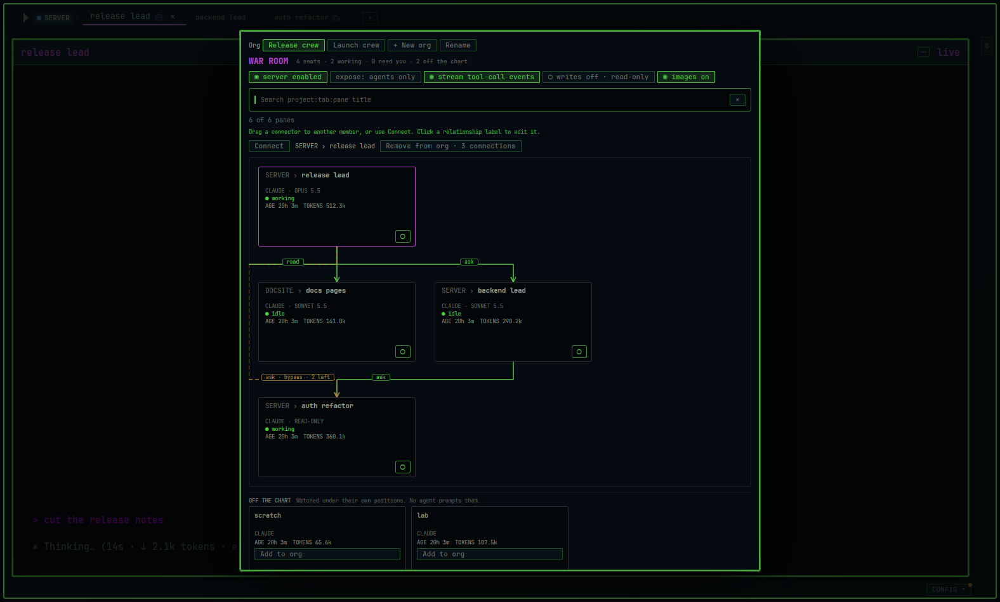

# War Room orgs and relationships are built

The large selected-agent context panel is gone. War Room now has named orgs, fixed-size pane cards and an explicit relationship builder. The optimized build is installed; reopen your Terminal Delight window to load it.

**Figure 1. Selecting a member highlights its card without expanding it.** This capture comes from the installed optimized build in a hidden native window. Names, session ages and token counts are test fixtures, separate from your live sessions.

## Make the relationship

1. Add both members to the same org.
2. Drag the small connector at the bottom-right of the source card onto the target card. **Connect** also opens the builder and lets you choose both members.
3. Choose **See**, **Read** or **Ask**, then **Save relationship**. The sentence above Save names who may reach whom; the arrow points toward the target.

A new draft has no permission selected. Dropping a connector or selecting a card grants nothing. Click an existing line label to change its permission or erase it. Cancel keeps the saved relationship unchanged.

## Name and arrange the org

**New org** creates an empty org after you enter its label. **Rename** changes that label while retaining its identity. Drag a whole card onto an org's label, or drop an available card onto the current chart. The drag preview is a small text outline; the original card keeps its dimensions.

Moving a member with connections shows their count and asks you to confirm their removal. Search remains global: a match belonging to another org carries its label and an **Open org** action. Use fuzzy words or `project:tab:pane title`.

Existing charts migrate into an **Unnamed org** with their seats and lines intact. Session age and context tokens remain on every pane card; missing measurements stay unknown. A saved member whose pane is unavailable stays visible as an unavailable card.

## What passed

- **2,801 tests passed; 17 ignored** in the complete serial suite.
- Three new model tests cover legacy migration, org identity and membership, and relationship validity.
- Three native GPUI interaction tests perform connector dragging, card dragging, move cancellation and confirmation, explicit permission selection, relationship editing and cancellation, search across orgs, create/rename typing, fixed card bounds and terminal focus restoration.
- Clippy passes with warnings denied for both terminal cores; formatting and diff checks pass.
- The optimized binary opens the native War Room and answers its control socket. Figure 1 was captured from that binary.

The drag test verifies that saving a new relationship without choosing a permission creates no line, then selects Read and saves it. The membership test starts with a live connection: cancelling the move preserves it, while confirming moves the same seat and removes its old connections. The saved state is serialized and restored without changing org identity or membership.

## Installed build and source

Installed binary: `/home/parker/.local/lib/terminal-delight/td-fdc799ee-0.5-war-room-orgs`.

SHA-256: `ad0ba6d2338b76206ae8c3345d5c810e96c960b3c52d26f5629e80759e11fa50`.

The launcher now selects this binary. The current running window remains on its earlier binary until reopened. This is a local development build for the planned 0.5.0 release.

Source: [War Room view and native interaction tests](../app/src/war_room_view.rs), [org and relationship model](../app/src/warroom.rs), [saved workspace state](../app/src/main.rs), [translated controls](../app/src/lang/chrome.rs), [test fixture cleanup](../app/src/pane.rs).

Plan: [approved scope and completed slices](../docs/plans/war-room-orgs/00-status.md).
