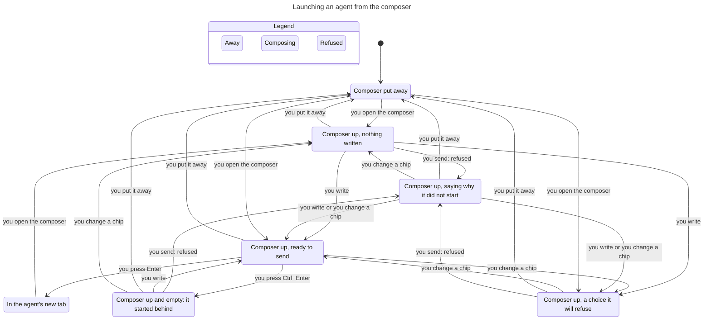
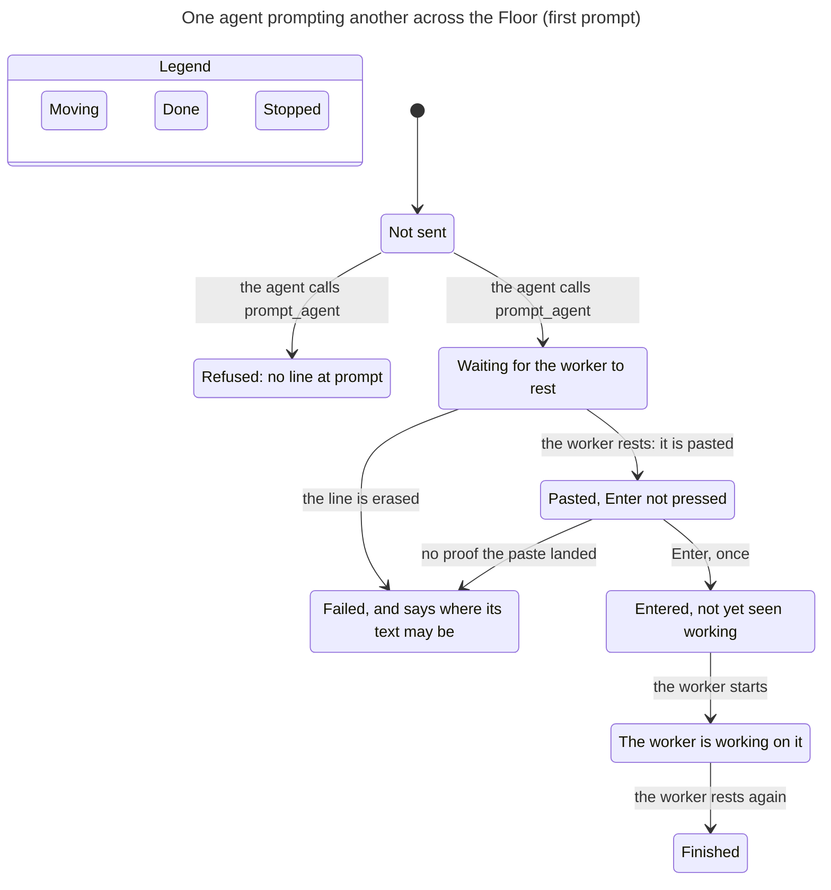
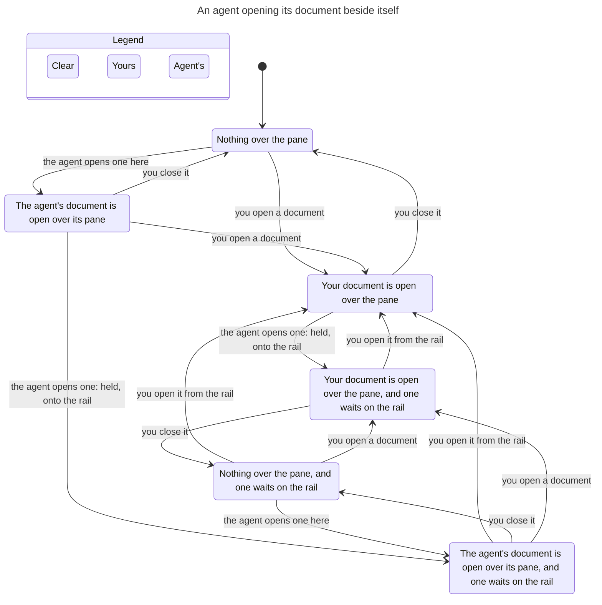

# User flows, as checked models

The flows a person lives in most, each a small TLA+ model with the code it stands for named in its header, and a `*-view.ts` that gives the pstack `/statechart` skill the reader's words.

- `Inbox.tla`: one agent through the INBOX shelves (`app/src/inbox.rs`, `shelve`, `Store::advance`). Holds: a question asked after you put a row away comes back to LOOK AT ME; a question is never on the quiet shelf.
- `SettingsBook.tla`: the Settings book (`app/src/settings_view.rs`). Holds: a panel shown in place never outlives the book; Esc goes back one level.

Run: `verify/check.sh verify/flows/Inbox.tla` and `verify/check.sh verify/flows/SettingsBook.tla`. Both rules of each were broken on purpose with `verify/mutate.sh` and caught.

## Three everyday flows (2026-11-11)

- `Launch.tla`: launching an agent from the composer (`entry_view.rs` `composer_send`, `open_composer`). Holds: a refusal says why and keeps what was written; Enter takes you to the agent's tab; Ctrl+Enter leaves you on an empty composer that says it started.
- `PromptAcross.tla`: one agent prompting another along a line drawn at `prompt` in the Threshing Floor (`prompt.rs`, `mcp.rs` `prompt_agent` and `prompt_status`). Holds, for two prompts to one worker: typed only while the worker is at rest; Enter only on proof the paste landed, and once; one prompt typed at a time, in send order; no line, nothing typed.
- `OpenBeside.tla`: an agent opening its document beside itself (`mcp.rs` `open_document`, `pane/doc.rs` `open_here`). Holds: an agent never replaces a document a person opened (it is held, onto the artifact rail); what was held is offered on the rail.

Run each with `verify/check.sh verify/flows/<Model>.tla`. Every rule was broken on purpose with `verify/mutate.sh` and read `BREAKS`: dropping the rest guard, the send-order guard or the paste-proof guard in `PromptAcross`; opening over any square in `OpenBeside`; a refusal with no note in `Launch`. The charts below were drawn by the pstack `/statechart` skill from each model with its `*-view.ts`.

### Launching an agent

### Prompting across the Floor (the first of two prompts)

### An agent opening its document

